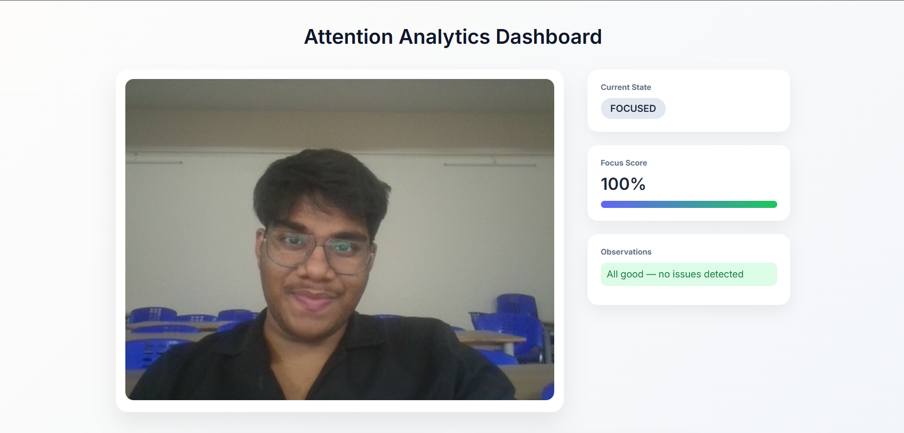
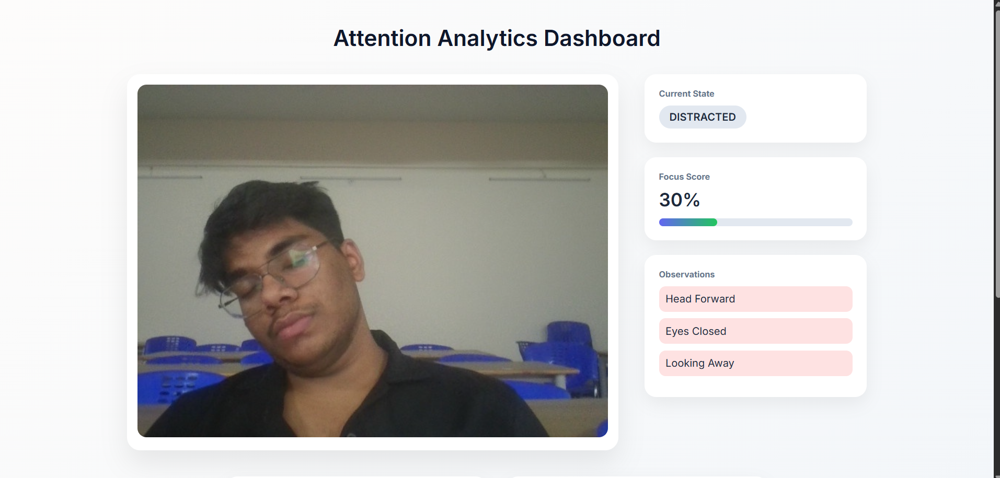
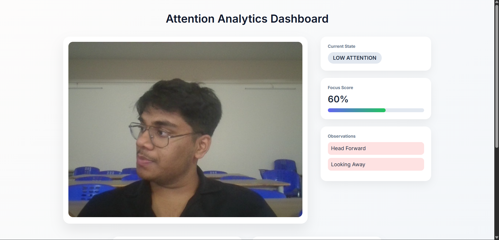

# AI-Based Real-Time Attention Monitoring System

**Live demo:** https://ai-attention-system.vercel.app (runs in your browser; video never leaves your device)

## Abstract

This project presents a real-time, web-based attention monitoring system that evaluates user engagement using computer vision. By integrating posture analysis and facial behavior tracking, the system estimates cognitive states such as focus, distraction, and drowsiness. The solution operates without any training dataset, relying on rule-based inference over pose and facial landmarks.

## Problem Statement

Maintaining attention during prolonged screen interaction is a critical challenge in educational and professional environments. Existing solutions often require intrusive hardware or large datasets. This project aims to develop a lightweight, real-time system that can monitor attention using only a standard webcam.

## Objectives

* To detect and analyze human posture in real time
* To identify facial behavioral cues such as eye closure and head direction
* To compute an attention score based on multiple parameters
* To classify user cognitive states dynamically
* To present results through an interactive web interface

## System Architecture

Webcam → Frame Capture (OpenCV) → Landmark Detection (MediaPipe Pose + Face Mesh) → Feature Extraction → Rule-Based Analysis → Flask Server → Web Dashboard

The browser version (`web/`) runs the same pipeline on the visitor's device: webcam → MediaPipe Tasks (Pose + Face Landmarker, WebAssembly) → the same rules ported to TypeScript → on-page dashboard. Video is never uploaded.

## Methodology

### 1. Landmark Detection

The system uses MediaPipe Pose and Face Mesh models to extract key body and facial landmarks from each video frame.

### 2. Feature Extraction

Relevant spatial relationships are computed, including:

* Head position relative to shoulders
* Eye openness
* Mouth movement
* Head orientation

### 3. Attention Scoring

A rule-based scoring system assigns penalties based on detected issues such as slouching, drowsiness, or distraction.

Every rule compares two distances in the same frame, so camera resolution and distance from the camera don't change the result:

| Issue | Measurement | Trips when | Penalty |
|---|---|---|---|
| Head Forward | Sideways nose offset from the shoulder midpoint ÷ shoulder width | above 0.20 | −20 |
| Slouching | Nose height above the shoulder line ÷ shoulder width | below 0.40 | −20 |
| Leaning | Height gap between the shoulders ÷ shoulder width | above 0.15 | −20 |
| Eyes Closed | Eyelid gap ÷ eye width, both eyes | below 0.15 | −30 |
| Yawning | Lip gap ÷ mouth width | above 0.40 | −20 |
| Looking Away | Nose position between the cheeks (0–1) | outside 0.30–0.70 | −20 |
| Frequent Yawning | Yawns in the last 60 s (a yawn = mouth open past the yawn limit for ≥ 1 s) | 2 or more | −20 |

Any single tripped check takes the score to 80 or below, out of Focused. Frequent Yawning needs a video stream, so it applies to the live camera and the Flask app, not to single photos; it stays on between yawns until the older yawn is more than 60 s old.

No face in view scores 0 (Critical). If the shoulders aren't visible (low visibility, or placed outside the frame, which MediaPipe does for close-ups), posture is skipped and reported as not checked.

The slouch limit comes from measuring 20 example photos: upright poses measured 0.46–0.65 and slouched ones 0.33–0.37. The other limits are starting values. All of them need tuning across more real people and cameras.

### 4. State Classification

Based on the computed score, the system classifies the user into one of the following states:

* **Focused**
* **Attentive**
* **Low Attention**
* **Distracted**
* **Critical**

## Features

* Real-time video processing
* Multi-modal analysis (posture + facial behavior)
* Attention score (0–100)
* Issue-specific feedback
* Dynamic cognitive state classification
* Web-based dashboard using Flask, plus a browser-only version that needs no server
* No dataset or training required

## Technologies Used

* Python
* OpenCV
* MediaPipe
* Flask
* HTML, CSS, JavaScript
* TypeScript, Vite, MediaPipe Tasks Vision (browser version)

## How to Run

1. Clone the repository
   git clone https://github.com/tanishhhk/ai_attention_system.git

2. Navigate to project folder
   cd ai_attention_system

3. Install dependencies
   pip install -r requirements.txt

4. Run the application
   python app.py

5. Open in browser
   http://127.0.0.1:5000/

`requirements.txt` pins `mediapipe==0.10.14`, because newer releases removed the `mp.solutions` API that `detector.py` uses.

### Browser version

```
cd web
npm install
npm run dev
```

### Example photos

`web/public/examples/<person>/` holds AI-generated photos (Google Gemini) of two fictional people in each scenario. `scripts/detect_examples.py` runs the browser version's MediaPipe models on them, keeps only photos that trip the check their scenario is meant to show, and writes the detected points to `web/src/examples.json`:

```
python scripts/detect_examples.py --face face_landmarker.task --pose pose_landmarker_lite.task
```

### Tests

Both versions run the same cases from `shared/rules_cases.json`:

```
python -m unittest discover tests
cd web && npm test
```

## Project Structure

```
ai_attention_system/
├── app.py               # Flask server and video stream
├── src/
│   ├── detector.py      # MediaPipe landmarks → named points
│   ├── detector_indices.py # Landmark numbers for the named points
│   └── rules.py         # Rule-based scoring (pure Python, no OpenCV/MediaPipe)
├── scripts/
│   └── detect_examples.py # Detects landmarks in the example photos for the website
├── shared/
│   └── rules_cases.json # Test cases shared by the Python and TypeScript rules
├── tests/
│   └── test_rules.py
├── web/                 # Browser version (Vite + TypeScript), deployed on Vercel
│   ├── index.html
│   ├── public/examples/ # AI-generated example photos, one folder per person
│   └── src/             # rules.ts, live.ts (camera + MediaPipe), examples.ts, figure.ts, readout.ts, main.ts
├── vercel.json
├── templates/
│   └── index.html
├── static/
│   └── style.css
├── requirements.txt
├── focused.png
├── distracted.png
├── low_attention.png
└── README.md
```

## Applications

* Online learning attention tracking
* Workplace productivity monitoring
* Human-computer interaction systems

## Key Contributions

* Combines posture and facial behavior for attention analysis
* Implements a rule-based cognitive scoring system
* Eliminates need for training datasets
* Provides real-time web-based visualization

## Output Demonstration

### Focused State



### Distracted State



### Low Attention State



## Results

The system successfully performs real-time attention monitoring and provides interpretable feedback through a scoring mechanism and issue identification. It demonstrates the feasibility of lightweight computer vision solutions for behavioral analysis without reliance on large datasets.

## Limitations

* Rule-based system may not generalize to all environments
* Performance depends on lighting and camera quality
* Does not perform true emotion classification

## Future Scope

* Integration with deep learning-based emotion recognition
* Audio alert system for prolonged inattention
* Deployment as a web or mobile application
* Historical analytics and attention tracking

## Conclusion

This project demonstrates an effective approach to real-time attention monitoring using computer vision. By combining posture and facial analysis, it provides a scalable and practical solution for enhancing engagement in digital environments.

## Author

Tanishk Jain
